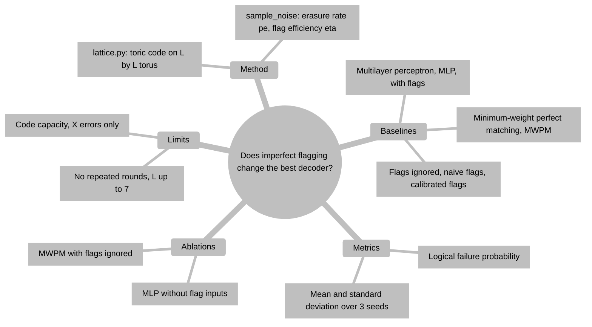
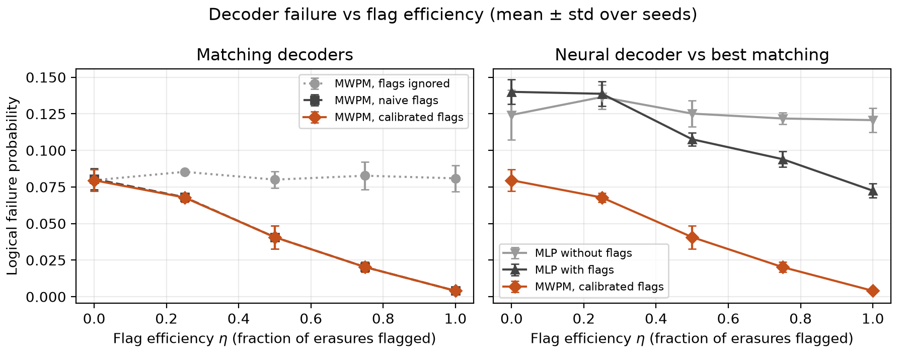
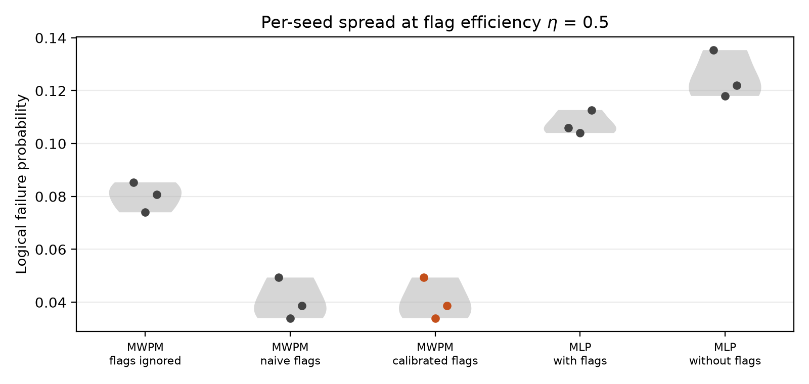
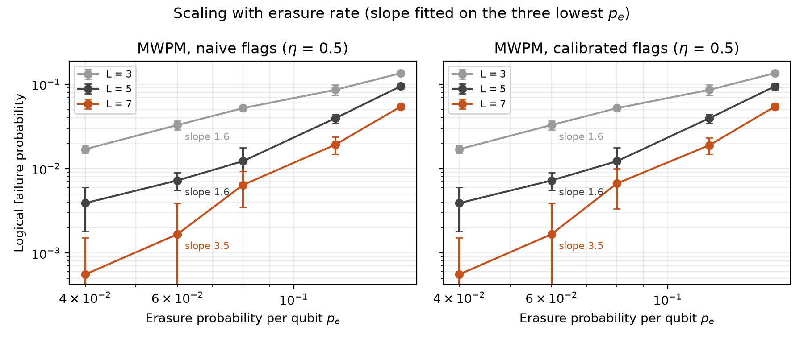

# Imperfect Erasure Flags in Toric-Code Decoding: Matching versus a Neural Decoder

  

**Abstract.** I simulate the toric code (code-capacity X-error model, distance L = 3, 5, 7) when only a fraction eta of erasures is flagged, and compare three minimum-weight perfect-matching (MWPM) weightings with a flag-aware multilayer perceptron (MLP) decoder. My hypothesis that recalibrating the prior of unflagged qubits would beat the naive flag-trusting matcher is falsified: the two decoders differ by at most 0.002 in logical failure probability, because matching is invariant to a uniform rescaling of the unflagged weights. A small MLP trained for 3000 steps does not match MWPM at L = 5; both findings are simulation results only.

## Problem and why it matters

Erasure conversion (Ma et al., 2023, doi:10.1038/s41586-023-06438-1) turns many physical faults into heralded erasures, and below-threshold quantum error correction (QEC) is now demonstrated (Zobrist et al., 2025, doi:10.1038/s41586-024-08449-y; Acharya et al., 2023, doi:10.1038/s41586-022-05434-1). Analyses usually assume every erasure is flagged. Real conversion has finite efficiency, so some erasures masquerade as Pauli errors. Recent decoder work covers learned decoding (Joo, 2026, doi:10.1140/epjqt/s40507-026-00492-0) and erasure recovery with fewer measurements (Matsumoto, 2027, doi:10.1007/s40314-026-03881-4), but not the imperfect-flag regime. See `docs/RESEARCH_GAP.md` for the related-work table (the supplied literature carries a single role label, so papers are grouped by function there).

## What is new here

- Flag efficiency eta is a first-class variable: failure is measured as a function of eta, not only at eta = 1.
- A prior-calibrated matcher (accounting for hidden erasures) is tested against the naive one, and the null result is explained, not hidden.
- The neural decoder is compared with the strongest matching baseline on identical test samples.

## Method



Noise: each qubit is erased with probability p_e (then X with probability 1/2), otherwise X with probability p = 0.01; an erasure is flagged with probability eta. MWPM uses Dijkstra distances on the dual torus and exact matching (networkx). *Calibrated* weights use P(X | unflagged) = ((1-p_e)p + p_e(1-eta)/2) / ((1-p_e) + p_e(1-eta)). The MLP (2 x 256 hidden units) takes syndrome, flags and eta and predicts the logical class of the error relative to a fixed reference correction. Details: `docs/METHOD.md`.

## Results

Experiment A: L = 5, p_e = 0.12, 1500 shots per seed, 3 seeds, mean ± std of logical failure probability (`results/summary.csv`).

| eta | MWPM flags ignored | MWPM naive flags | MWPM calibrated | MLP with flags | MLP without flags |
|---|---|---|---|---|---|
| 0.00 | 0.0796 ± 0.0073 | 0.0804 ± 0.0073 | 0.0796 ± 0.0073 | 0.1400 ± 0.0085 | 0.1242 ± 0.0169 |
| 0.25 | 0.0853 ± 0.0013 | 0.0680 ± 0.0027 | 0.0678 ± 0.0030 | 0.1387 ± 0.0084 | 0.1364 ± 0.0081 |
| 0.50 | 0.0800 ± 0.0057 | 0.0407 ± 0.0079 | 0.0407 ± 0.0079 | 0.1076 ± 0.0045 | 0.1251 ± 0.0091 |
| 0.75 | 0.0827 ± 0.0093 | 0.0202 ± 0.0034 | 0.0202 ± 0.0034 | 0.0940 ± 0.0055 | 0.1218 ± 0.0040 |
| 1.00 | 0.0809 ± 0.0089 | 0.0040 ± 0.0012 | 0.0040 ± 0.0012 | 0.0724 ± 0.0047 | 0.1207 ± 0.0081 |



*Takeaway: failure falls steadily with flag efficiency for flag-using decoders, and naive and calibrated matching overlap everywhere.*



*Takeaway: at eta = 0.5 the matching variants sit well below both MLPs, and the calibrated and naive points coincide.*

Experiment B (L = 3, 5, 7; eta = 0.5; 1200 shots per seed): the maximum per-seed difference between naive and calibrated matching is 0.0008 (`results/slopes.json`); over experiment A it is 0.002. Slopes of log failure against log p_e on the three lowest p_e are 1.62 (L = 3), 1.64 (L = 5) and 3.53 (L = 7) (`results/slopes.json`).



*Takeaway: larger L lowers failure at fixed p_e; the L = 7 slope rests on a handful of failures per cell and is noisy.*

## Discussion, including negative results

- **H1 is falsified.** Calibration changes nothing measurable. The reason is structural: once flagged edges have weight about 0, all unflagged edges share one weight, and the minimum-weight matching does not change when a common weight is rescaled. Calibration would only matter if unflagged qubits had unequal priors (for example position-dependent hidden-erasure rates), which this model does not have.
- **H2 holds trivially, and more strongly than expected.** The MLP is worse than matching at every eta, and at eta = 0 (flags carry no information) it fails at 0.1242 to 0.1400 against 0.0796 for matching. A 3000-step MLP at L = 5 is under-trained; I did not tune it, so this says little about well-tuned learned decoders.
- Ignoring flags costs about 0.081 at eta = 1 versus 0.0040 with flags, so flags are the key resource; at eta = 0.25 the benefit is already 0.0853 versus 0.0680.

## Limitations

Code-capacity noise, X errors only, perfect syndrome measurement, no repeated rounds, toric (not planar) geometry, an untuned MLP, and 1200-1500 shots per cell, so low-failure cells (L = 7, small p_e) have large relative error. These are simulation results with no hardware claim.

## Future work

Add circuit-level noise with repeated rounds and position-dependent erasure rates (where calibration should matter), reuse the flag-aware weights for the bivariate bicycle codes of Bravyi et al. (2024, doi:10.1038/s41586-024-07107-7), and train the neural decoder with more steps and convolutional structure. On hardware, eta would be estimated from erasure-conversion calibration data.

Related work by the author: [repetition-code-breakeven-map](https://github.com/pradeepdegalaroyal/repetition-code-breakeven-map) (exact decoding of a repetition-code memory) and [erasure-local-stabiliser-measurements](https://github.com/pradeepdegalaroyal/erasure-local-stabiliser-measurements) (measurement counts for erasure recovery).

## Reproducibility

```
pip install -r requirements.txt
python -m pytest -q
python experiments/run_all.py --quick   # under 1 minute
python experiments/run_all.py           # full run, 870 s (results/run_info.json)
```

Hardware: Windows 11, Python 3.11.9, CPU only (6 threads), numpy 2.2.6, scipy 1.17.1, pandas 2.3.3, matplotlib 3.11.1, networkx 3.6.1, torch 2.11. Seeds 0, 1, 2.

## Project structure

```
src/flagdecode/   lattice.py (toric code, noise), decoders.py (MWPM), neural.py (MLP)
experiments/      run_all.py, plots.py
tests/            test_flagdecode.py
docs/             RESEARCH_GAP.md, METHOD.md
results/          eta_sweep.csv, erasure_scaling.csv, summary.csv, slopes.json, run_info.json
figures/          fig1-fig3 (200 dpi)
```

## Citation

```bibtex
@software{chenchupradeep2026flagdecode,
  author  = {Degala Chenchupradeep},
  title   = {Imperfect Erasure Flags in Toric-Code Decoding: Matching versus a Neural Decoder},
  year    = {2026},
  version = {0.1.0},
  url     = {https://github.com/pradeepdegalaroyal/imperfect-erasure-flag-decoding-toric-code},
  license = {MIT}
}
```

MIT license (`LICENSE`). See also `CITATION.cff`.
